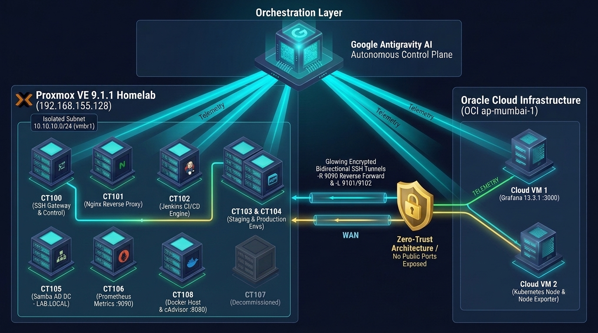

# Enterprise Hybrid Homelab & Multi-Cloud Infrastructure

[](https://www.proxmox.com)
[-F80000?logo=oracle)](https://cloud.oracle.com)
[](https://jenkins.io)
[](https://prometheus.io)
[](https://deepmind.google)

---

## 🏛️ Architectural Overview

An enterprise hybrid cloud architecture bridging an on-premise **Proxmox VE 9.1.1** cluster (`192.168.155.128`) operating on a private Class C subnet (`10.10.10.0/24`) to **Oracle Cloud Infrastructure (OCI)** compute nodes via encrypted, zero-trust bidirectional SSH tunnels.



### 📄 Comprehensive Architecture Documentation
- **Word Document:** [`docs/Hybrid_Infrastructure_DevOps_Architecture.docx`](docs/Hybrid_Infrastructure_DevOps_Architecture.docx)
- **PDF Document:** [`docs/Hybrid_Infrastructure_DevOps_Architecture.pdf`](docs/Hybrid_Infrastructure_DevOps_Architecture.pdf)
- **Architecture Diagram:** [`docs/hybrid_infrastructure_architecture.jpg`](docs/hybrid_infrastructure_architecture.jpg)

---

## 🤖 Antigravity Autonomous Operations & Control Plane

The entire infrastructure lifecycle—spanning provisioning, diagnosis, configuration, multi-cloud tunnel orchestration, telemetry consolidation, and CI/CD maintenance—is **autonomously governed by Google Antigravity**.

The administrator expresses objectives in natural language; Antigravity translates intent into deterministic state changes across on-premise containers and public cloud nodes.

### Automated Actions Handled by Antigravity:
- **Zero-Trust Hybrid Mesh:** Autonomous configuration of persistent systemd daemons (`prometheus-cloud-tunnel.service`, `k8s-cloud-tunnel.service`).
- **Telemetry Convergence:** Dynamic Prometheus configuration scraping 10 distinct targets across on-premise and cloud tiers.
- **Autonomous Self-Healing:** Diagnostic root cause analysis, swap allocation on Oracle Cloud micro instances, and Grafana database optimization.
- **Resource Reclaiming:** Gracefully migrated Grafana to OCI Cloud VM 1 and powered off on-premise node `CT107`.

---

## 🖥️ Node & Workload Roster

| Identifier | IP Address | Platform | CPU / RAM | Primary Hosted Workload |
|---|---|---|---|---|
| **CT100 (control-node)** | `10.10.10.100` | Proxmox LXC | 2 vCPU / 1 GB | Ansible Hub, SSH Keymaster, Systemd Hybrid Tunnel Gateway |
| **CT101 (terraform-test)** | `10.10.10.101` | Proxmox LXC | 2 vCPU / 1 GB | Nginx Reverse Proxy, Domain Joined (`lab.local`), SSL Termination |
| **CT102 (jenkins)** | `10.10.10.102` | Proxmox LXC | 2 vCPU / 2 GB | Jenkins Automation Server, Docker CLI, Git SCM Poller |
| **CT103 (staging)** | `10.10.10.103` | Proxmox LXC | 2 vCPU / 1 GB | Pre-Production Staging Runtime, Domain Joined (`lab.local`) |
| **CT104 (production)** | `10.10.10.104` | Proxmox LXC | 2 vCPU / 1 GB | Production Application Tier, Domain Joined (`lab.local`), DB Host |
| **CT105 (samba-dc)** | `10.10.10.105` | Proxmox LXC | 2 vCPU / 1 GB | Active Directory Domain Controller (`LAB.LOCAL`), Kerberos, DNS |
| **CT106 (prometheus)** | `10.10.10.106` | Proxmox LXC | 2 vCPU / 1 GB | Prometheus Metrics Engine (`:9090`), Alertmanager |
| **CT107 (grafana)** | `10.10.10.107` | Proxmox LXC | 2 vCPU / 1 GB | *(Decommissioned)* Workload migrated to Cloud VM 1 by Antigravity |
| **CT108 (docker-host)** | `10.10.10.108` | Proxmox LXC | 2 vCPU / 1.5 GB | Docker Container Runtime, cAdvisor (`:8080`), Web App (`:80`) |
| **cloud-vm-1-grafana** | `137.23.38.177` | Oracle Cloud | 1 OCPU / 1 GB | Grafana 13.3.1 Enterprise/OSS (`:3000`), 2 GB Swap, Unified Dashboard |
| **cloud-vm-2-kubernetes** | `130.210.84.113` | Oracle Cloud | 2 OCPU / 12 GB | Node Exporter (`:9100`), Kubernetes Cluster Node Candidate |

---

## 🔒 Hybrid Cloud Synchronization (Zero-Trust)

Because the homelab resides behind double-NAT with no public IPv4 address, and Oracle Cloud compute instances strictly filter inbound traffic:
- **Reverse Port Forward (`-R 9090:10.10.10.106:9090`):** Exposes on-premise Prometheus to Cloud Grafana over `127.0.0.1:9090` without opening public ports.
- **Local Port Forwards (`-L 0.0.0.0:9101:127.0.0.1:9100` & `9102`):** Brings Cloud VM 1 and Cloud VM 2 telemetry securely into the private homelab subnet.
- **Systemd Watchdogs:** Monitored by `systemd` units in `systemd/` with `ServerAliveInterval 30` and automatic 10-second restarts.

---

## 🚀 CI/CD Pipeline Workflow

1. Developers push commits to GitHub `main` branch.
2. Jenkins on `CT102` detects commits via Git SCM polling (`* * * * *`).
3. Jenkins runs the pipeline defined in `Jenkinsfile`:
   - Checks out code.
   - Applies Terraform infrastructure in `terraform/`.
   - Executes Ansible playbooks in `ansible/deploy-app.yml` targeting `CT108`.
   - Runs post-deployment HTTP smoke tests.

---

## 📁 Repository Structure

```
.
├── Jenkinsfile                             # Multi-stage CI/CD pipeline definition
├── README.md                               # Infrastructure architecture documentation
├── inventory.ini                           # Unified 10-node Ansible inventory
├── ansible/                                # Automation playbooks (Nginx, Samba, Docker)
├── app/                                    # Application source code & Dockerfile
├── dashboards/                             # Exported Grafana dashboards
│   └── homelab-overview.json               # Unified 10-node status dashboard
├── docs/                                   # Architecture specifications & diagrams
│   ├── Hybrid_Infrastructure_DevOps_Architecture.docx
│   ├── Hybrid_Infrastructure_DevOps_Architecture.pdf
│   └── hybrid_infrastructure_architecture.jpg
├── monitoring/                             # Centralized Prometheus configuration
│   └── prometheus.yml                      # 10-target scrape configuration
├── systemd/                                # Persistent SSH tunnel service units
│   ├── k8s-cloud-tunnel.service
│   └── prometheus-cloud-tunnel.service
└── terraform/                              # Infrastructure as Code (OCI compute & security)
    ├── main.tf
    └── variables.tf
```
