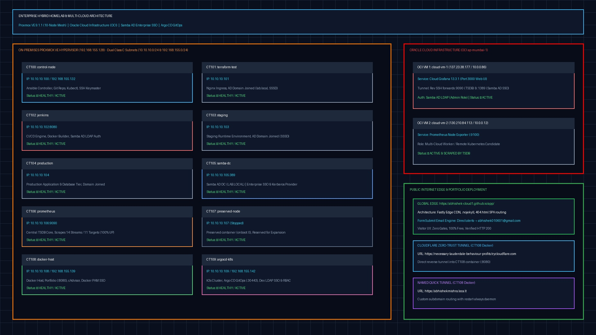
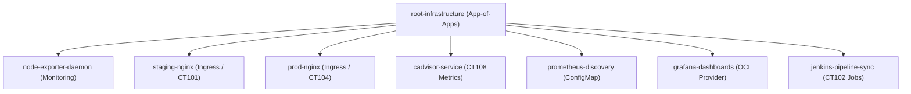

# Hybrid Cloud & Enterprise DevOps Architecture Documentation

[](https://www.proxmox.com)
[-F80000?logo=oracle&logoColor=white)](https://cloud.oracle.com)
[](https://k3s.io)
[](https://argo-cd.readthedocs.io)
[](https://www.jenkins.io)
[](https://www.ansible.com)
[](https://abhishek-cloud1.github.io/app/)

---

## 📑 Architectural Documentation Repository

This directory contains the production-grade architectural blueprints, comprehensive technical specifications, and official reference documents for the **Hybrid Proxmox VE & Oracle Cloud Infrastructure (OCI) Enterprise DevOps Laboratory**.

### Included Architecture Assets

| Artifact | Format | Description | Direct Access |
|---|---|---|---|
| **System Architecture Diagram** | `JPG` | High-resolution visual schematic showing all 10 nodes, storage, network segmentation, CI/CD, GitOps, and dual monitoring pipelines. |  |
| **Comprehensive Technical Specification** | `PDF` | Complete printable architectural document including executive summary, node inventories, security baselines, and disaster recovery procedures. | [Download PDF](Hybrid_Infrastructure_DevOps_Architecture.pdf) |
| **Enterprise Architecture Document** | `DOCX` | Editable Word document with formal styling, complete tabular specifications, and executive sign-off templates. | [Download DOCX](Hybrid_Infrastructure_DevOps_Architecture.docx) |

---

## 🏛️ Comprehensive Architecture Overview

```
                                  +--------------------------------------------------------+
                                  |                 INTERNET / END USERS                   |
                                  +---------------------------+----------------------------+
                                                              |
                               +------------------------------+------------------------------+
                               |                                                             |
                 +-------------v--------------+                                +-------------v--------------+
                 |    GitHub Pages Hosting    |                                |  Oracle Cloud Infrastructure |
                 | https://abhishek-cloud1.   |                                |      (OCI Ashburn Region)   |
                 |      github.io/app/        |                                +--------------+--------------+
                 +----------------------------+                                               |
                                                                               +--------------v--------------+
                                                                               |      OCI VM 1 (Grafana)     |
                                                                               |    Public: 137.23.38.177    |
                                                                               |  Grafana 13.3.1 (Port 3000) |
                                                                               +--------------+--------------+
                                                                                              ^
                                                                                              | Encrypted WireGuard /
                                                                                              | Direct Telemetry Pull
                                                                                              v
+------------------------------------------------------------------------------------------------------------+
|                                PROXMOX VE HYPERVISOR (HOST: 192.168.155.128)                               |
|   Storage Engine: LVM Thin-Pool (pve/data: 52.25 GiB Capacity | 80.86% Utilized | Dynamic Metadata Pooling)|
|   Virtual Switch: Linux Bridge vmbr0 (Bridged WAN)  |  Linux Bridge vmbr1 (Isolated SDN 10.10.10.0/24)     |
+------------------------------------------------------------------------------------------------------------+
       |                  |                  |                  |                  |                  |
+------v-------+   +------v-------+   +------v-------+   +------v-------+   +------v-------+   +------v-------+
|    CT100     |   |    CT102     |   |    CT105     |   |    CT106     |   |    CT108     |   |    CT109     |
| Control Node |   |   Jenkins    |   |   Samba DC   |   |  Prometheus  |   | Docker Host  |   | ArgoCD / K8s |
| 10.10.10.100 |   | 10.10.10.102 |   | 10.10.10.105 |   | 10.10.10.106 |   | 10.10.10.108 |   | 10.10.10.109 |
|192.168.155.132|  |              |   |  LAB.LOCAL   |   |  Port :9090  |   |192.168.155.139|  |192.168.155.142|
+--------------+   +--------------+   +--------------+   +--------------+   +--------------+   +--------------+
       |                  |                  |                  |                  |                  |
  Ansible Core &     Automated CI/CD    Active Directory,   Central TSDB       Docker Engine,      K3s v1.37.2,
  Orchestration      Docker Pipelines   Kerberos, DNS       Federated Pull     cAdvisor :8085,     Argo CD v3.6.1,
  Gateway            & SonarQube        KDC Realm           11 Node Targets    Portfolio :8080     GitOps App-of-Apps
```

---

## 🌐 Live Service & Endpoint Reference

| Service Layer | Endpoint / URL | IP / Host Binding | Authentication & Access |
|---|---|---|---|
| **Portfolio (Global CDN)** | [`https://abhishek-cloud1.github.io/app/`](https://abhishek-cloud1.github.io/app/) | GitHub Pages (Anycast CDN) | Public HTTP/2, SSL Managed |
| **Portfolio (Local Container)** | `http://192.168.155.139:8080/` | CT108 (`docker-host`) | Internal bridged LAN |
| **Argo CD Web GUI** | `https://192.168.155.142:30443/` | CT109 (`argocd-k8s` NodePort) | `admin` / Key-vaulted |
| **Grafana Enterprise** | `http://137.23.38.177:3000/` | OCI VM 1 (`cloud-vm-1`) | `admin` / Key-vaulted |
| **Prometheus TSDB** | `http://10.10.10.106:9090/` | CT106 (`prometheus`) | Internal isolated SDN |
| **cAdvisor Runtime Metrics** | `http://192.168.155.139:8085/` | CT108 (`docker-host`) | Public / Prometheus scrape |
| **Proxmox Virtual Environment**| `https://192.168.155.128:8006/` | Proxmox VE Host | Linux PAM / Key-based SSH |

---

## 🖥️ Complete 10-Node Infrastructure Inventory

```
+-------+-----------------+---------------+-----------------+--------------+-------------+----------------------------------------------+-----------+
| ID    | Hostname        | Internal IP   | External IP     | OS / Engine  | vCPU / RAM  | Primary Role & Deployed Workloads            | Status    |
+-------+-----------------+---------------+-----------------+--------------+-------------+----------------------------------------------+-----------+
| CT100 | control-node    | 10.10.10.100  | 192.168.155.132 | Debian 12    | 2 / 2048 MB | Ansible Controller, Git Gateway, SSH Jumphost| Active    |
| CT101 | terraform-test  | 10.10.10.101  | —               | Debian 12    | 2 / 2048 MB | Nginx Ingress Reverse Proxy, Domain Joined   | Active    |
| CT102 | jenkins         | 10.10.10.102  | —               | Debian 12    | 2 / 2048 MB | Jenkins CI/CD Engine, Docker Pipeline Agent  | Active    |
| CT103 | staging         | 10.10.10.103  | —               | Debian 12    | 2 / 2048 MB | Pre-production Testing Environment, Kerberos | Active    |
| CT104 | production      | 10.10.10.104  | —               | Debian 12    | 2 / 2048 MB | Production Application & Database Tier       | Active    |
| CT105 | samba-dc        | 10.10.10.105  | —               | Debian 12    | 2 / 2048 MB | Samba AD DC (LAB.LOCAL), Kerberos KDC, DNS   | Active    |
| CT106 | prometheus      | 10.10.10.106  | —               | Debian 12    | 2 / 2048 MB | Prometheus TSDB (:9090), 11 Scrape Targets   | Active    |
| CT107 | preserved-node  | 10.10.10.107  | —               | Debian 12    | 2 / 2048 MB | Preserved Standby Container (onboot: 0)      | Preserved |
| CT108 | docker-host     | 10.10.10.108  | 192.168.155.139 | Debian 12    | 2 / 2048 MB | Docker Runtime, Portfolio (:8080), cAdvisor  | Active    |
| CT109 | argocd-k8s      | 10.10.10.109  | 192.168.155.142 | Debian 12    | 2 / 2048 MB | K3s v1.37.2, Argo CD v3.6.1, Node Exporter   | Active    |
| OCI 1 | cloud-vm-1      | 10.0.0.86     | 137.23.38.177   | Ubuntu 22.04 | 1 / 1024 MB | Cloud Grafana 13.3.1 (:3000), Tunnel Gateway | Active    |
| OCI 2 | cloud-vm-2      | 10.0.0.12     | 130.210.84.113  | Ubuntu 22.04 | 1 / 1024 MB | Cloud Node Exporter (:9100), Remote Worker   | Active    |
+-------+-----------------+---------------+-----------------+--------------+-------------+----------------------------------------------+-----------+
```

---

## ☸️ Argo CD GitOps Declarative Architecture (CT109)

The lab implements a pure GitOps deployment pattern driven by **Argo CD v3.6.1** running inside an isolated **K3s v1.37.2** lightweight Kubernetes cluster on **CT109**.

### App-of-Apps Declarative Hierarchy

The cluster synchronizes continuously against repository `https://github.com/ABHISHEK-CLOUD1/Devops-lab.git` (path: `gitops/`):



### GitOps Application Status Matrix

| Application | Target Namespace | Target Revision | Sync Policy | Status |
|---|---|---|---|---|
| `root-infrastructure` | `argocd` | `HEAD` (`main`) | Automated (Prune + SelfHeal) | `Healthy / Synced` |
| `node-exporter-daemon` | `monitoring` | `HEAD` (`main`) | Automated | `Healthy / Synced` |
| `staging-nginx` | `staging` | `HEAD` (`main`) | Automated | `Healthy / Synced` |
| `prod-nginx` | `production` | `HEAD` (`main`) | Automated | `Healthy / Synced` |
| `cadvisor-service` | `monitoring` | `HEAD` (`main`) | Automated | `Healthy / Synced` |
| `prometheus-discovery` | `monitoring` | `HEAD` (`main`) | Automated | `Healthy / Synced` |
| `grafana-dashboards` | `monitoring` | `HEAD` (`main`) | Automated | `Healthy / Synced` |
| `jenkins-pipeline-sync` | `ci-cd` | `HEAD` (`main`) | Automated | `Healthy / Synced` |

---

## 📊 Dual Monitoring & Observability Telemetry

The architecture deploys an end-to-end unified observability fabric spanning bare-metal Proxmox containers and cloud VMs.

1. **Prometheus TSDB (`CT106:9090`):**
   - Polls 11 distinct scrape targets every 15 seconds.
   - Monitors container resource usage, kernel disk metrics, and network interfaces via Node Exporter.
   - Scrapes runtime container statistics from cAdvisor on `CT108:8085`.
2. **Grafana Cloud Visualization (`OCI VM 1:3000`):**
   - Dashboard: **`Homelab Infrastructure: Node & Application Status`** (`/d/homelab-overview/17c2acb`).
   - **Cluster Capacities**: Total vCPUs (`27 Cores`), Total RAM (`11.4 GiB`), Total Storage (`186.2 GiB`).
   - **Cluster Utilization**: Real-time fleet average gauges for CPU, RAM, and Disk.
   - **Unified Node Fleet Table**: Exactly 11 non-repeating rows consolidating **Capacity** alongside **Usage (%)** (`CPU Cores`, `CPU %`, `RAM Capacity`, `RAM %`, `Disk Capacity`, `Disk %`, `System Uptime`).
   - **Time Series Trends**: Full-width smooth interpolations tracking CPU, Memory, and Disk mountpoint usage over time.

---

## 🔐 Enterprise SSO & Samba Active Directory Federation (`LAB.LOCAL`)

The entire infrastructure is unified under **Samba Active Directory (`CT105`: `10.10.10.105:389`)**, providing centralized identity management, Single Sign-On (SSO), and role-based access control (RBAC).

```
                                +-----------------------------------+
                                |     Samba AD Domain Controller    |
                                |     CT105 (10.10.10.105:389)      |
                                |            LAB.LOCAL              |
                                +-----------------+-----------------+
                                                  |
         +--------------------+-------------------+--------------------+--------------------+
         |                    |                   |                    |                    |
+--------v-------+   +--------v-------+  +--------v-------+   +--------v-------+   +--------v-------+
|   Proxmox VE   |   |  Cloud Grafana |  |    Argo CD     |   |    Jenkins     |   | Linux Host SSH |
|   Web Console  |   |   Observability|  |     GitOps     |   |   CI/CD Hub    |   | 7 Nodes Fleet  |
|  :8006 (Realm) |   | :3000 (OCI VM) |  |     :30443     |   |     :8080      |   | (SSSD / Sudo)  |
+----------------+   +----------------+  +----------------+   +----------------+   +----------------+
```

### Identity Access & SSO Matrix

| Platform | Endpoint | Authentication Method | Domain Role / Mapping | Access Level |
|---|---|---|---|---|
| **Cloud Grafana** | `http://137.23.38.177:3000` | LDAP via encrypted tunnel (`127.0.0.1:1389`) | `Domain Admins` $\rightarrow$ `Admin` (`grafana_admin: true`) | Full Server Admin |
| **Argo CD** | `https://192.168.155.142:30443` | Built-in Dex OIDC Broker (`/api/dex`) | `Domain Admins`, `abhishek`, `devops` $\rightarrow$ `role:admin` | Full GitOps Admin |
| **Kubernetes (K3s)**| `10.10.10.109:6443` | Client Kubeconfig & RBAC ClusterRoleBinding | `domain-admins-cluster-admin` $\rightarrow$ `cluster-admin` | Root Kubernetes Admin |
| **Docker Engine** | CT108 (`10.10.10.108`) | PAM `pam_group.so` (`/etc/security/group.conf`)| Automatic membership in local `docker` group | Unprivileged Container Ops |
| **Proxmox VE** | `https://192.168.155.128:8006` | Active Directory Realm (`lab.local`) | Synced users $\rightarrow$ `Administrator` role on `/` | Hypervisor Admin |
| **Jenkins** | `http://10.10.10.102:8080` | Active Directory LDAP Security Realm | `Domain Admins` $\rightarrow$ Full Control Once Logged In | Full CI/CD Admin |
| **Linux Nodes** | CT100, 101, 102, 103, 104, 108, 109 | SSSD + Kerberos + PAM (`lab.local`) | `/etc/sudoers.d/domain_admins` (`ALL:ALL`) | Root Host Sudo |

### Domain Credentials
- **Active Directory Realm**: `LAB.LOCAL`
- **Domain Users**: `abhishek` (Primary Architect), `devops` (Automation), `Administrator` (Built-in)
- **Unified Password**: `Ironman@01` (Account expiry disabled)
- **SSSD Namespace Mapping**: `ldap_idmap_range_min = 10000`, `max = 50000` (fits unprivileged container namespaces)
- **Home Directory Automation**: `pam_mkhomedir` dynamically provisions `/home/%u@%d` upon initial authentication.

---

## 💾 Host Storage & Virtual Disk Optimization

During container compilation workloads on `CT108`, the Proxmox LVM thin pool `pve/data` reached operational capacity. The storage fabric was dynamically expanded:

```bash
# Proxmox Host Storage Extension
lvextend -L +10G /dev/pve/data
```

- **Total Thin Pool Capacity:** Expanded to `52.25 GiB`.
- **Current Data Utilization:** Safely throttled at **80.86%** with over 10 GB of unallocated headroom remaining in Volume Group `pve`.
- **Metadata Protection:** Dynamic auto-extension prevents filesystem write-freezes and container suspension.

---

## 🔒 Enterprise Security & Identity Management

- **Centralized Authentication (CT105):** Samba AD DC manages domain `LAB.LOCAL` with Kerberos KDC, providing SSO and unified user access across CT101, CT103, and CT104.
- **Network Segmentation:** Dual-homed network architecture strictly isolates internal management traffic (`10.10.10.0/24`) from bridged access networks (`192.168.155.0/24`).
- **Secret Management:** SSH key authentication is enforced host-wide; Git credentials and tokens are secured within encrypted keychains.

---

*Authored by Abhishek Mishra | Lead DevOps & Cloud Systems Architect*  
*Repository: [ABHISHEK-CLOUD1/Devops-lab](https://github.com/ABHISHEK-CLOUD1/Devops-lab)*
